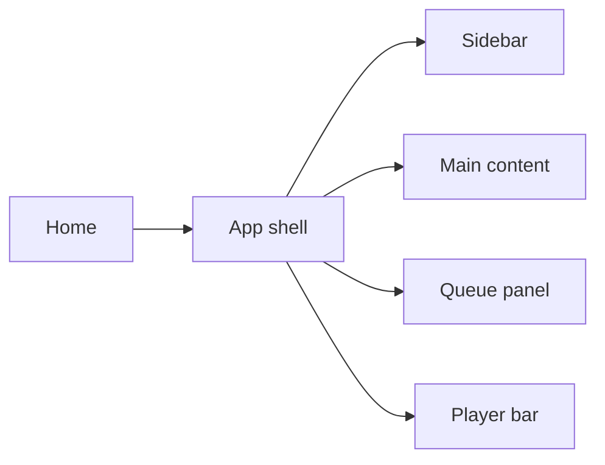
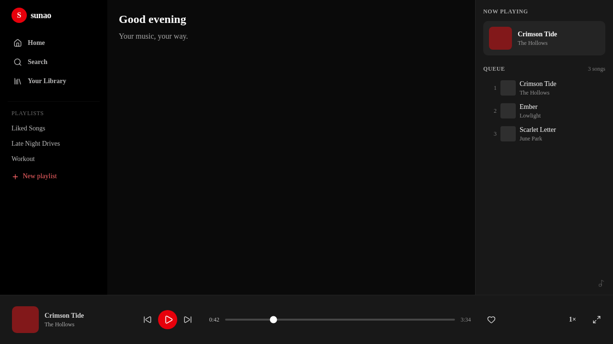
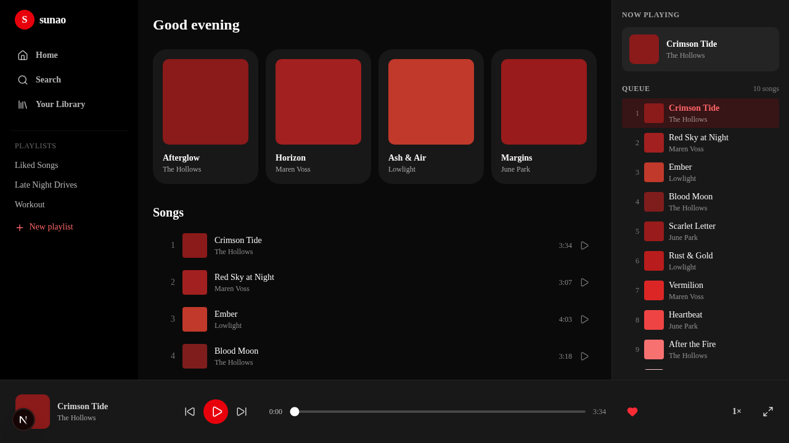
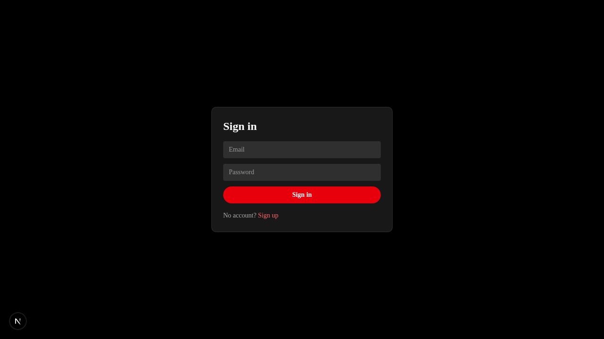

# sunao

A Spotify-like music player. Red theme, dark UI.

## Docs
See [docs/README.md](docs/README.md) for the wiki (stack, architecture, design system, workflows, roadmap).

## Feature map
<!-- Updated after each phase via /maintain-verification-skill -->



| Phase | Status | Evidence |
|---|---|---|
| 0 Scaffold | ✅ done |  |
| 1 Audio playback core | ✅ done |  |
| 2 Data layer (Supabase) | ✅ done |  |
| 3 Library & playlists | ✅ done | — |
| 4 Auth | ✅ done |  |
| 5 Polish & perf | ⬜ | — |
| 6 Deploy | ⬜ | — |

## Dev
```bash
pnpm install
pnpm dev
```
