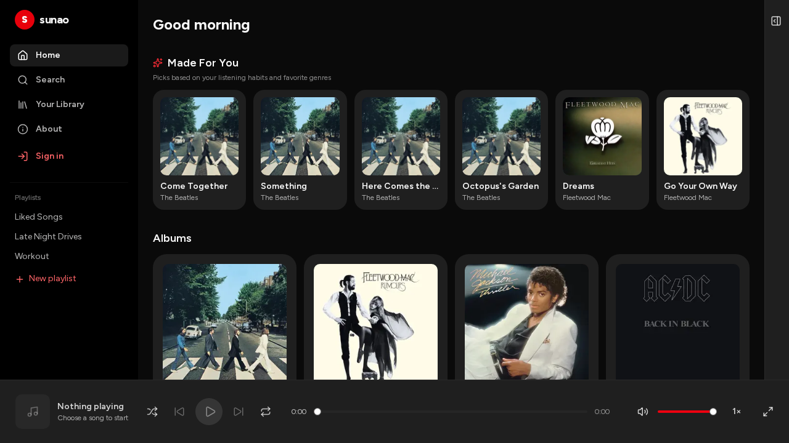
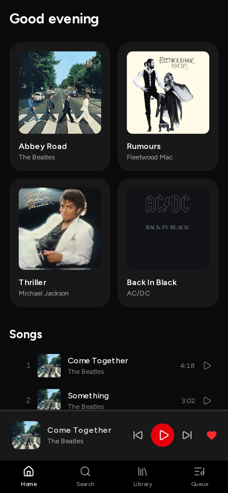
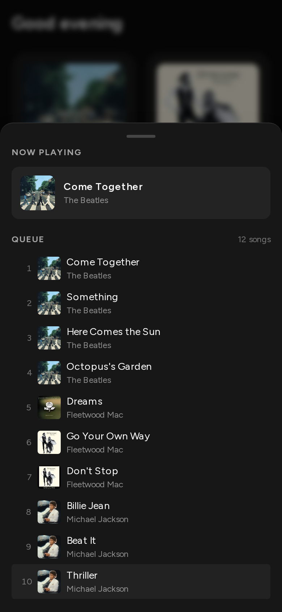

# sunao

A Spotify-like music player. Red theme, dark UI. Runs with or without a Supabase backend. Built with Next.js 16, React 19, Tailwind v4, shadcn/ui on Base UI, Supabase, Zustand, and TanStack Query.

**Live demo:** https://sunao-omega.vercel.app


Full-resolution video: [MP4](artifacts/readme/demo.mp4) · [WebM](artifacts/readme/demo.webm).

## Screenshots

| Home | Search |
|---|---|
|  |  |

| Library | Playlist |
|---|---|
|  |  |

| Now playing | Collapsed queue |
|---|---|
|  |  |

| Sign in | Sign up |
|---|---|
|  |  |

| Mobile home | Mobile queue |
|---|---|
|  |  |

Captured from a production build; regenerate with [scripts/capture-readme.mjs](scripts/capture-readme.mjs).

## Features

Playback
- Play / pause, previous / next, and auto-advance when a track ends
- Volume control: responsive slider, mute toggle button, and keyboard volume shortcuts (`↑`/`↓`), persisted in `localStorage`
- Shuffle mode: context-aware queue randomization preserving the active song at index 0 and cleanly restoring original queue on toggle
- Repeat modes: 3-state toggle (`off` / `all` / `one`) wired into audio `ended` event
- Comprehensive keyboard shortcuts: `Space` (play/pause), `Shift+N` / `J` (next), `Shift+P` / `K` (prev), `L` (like/unlike current track), `↑`/`↓` (volume up/down), input-guarded against text entry
- Seek scrubber bound to the audio element's real duration, with position and total labels
- Playback speed: 0.5×, 1×, 1.25×, 1.5×, 2×
- Like / unlike the current track — persisted (a versioned `localStorage` library document without a backend; a `liked_songs` table in Supabase mode), with optimistic updates and an Undo toast on removal
- Buffering spinner, debounced 200ms so it does not flash on fast loads
- Audio: 30-second previews from the iTunes Search API (no key), cached per title + artist, falling back to a bundled sample tone
- Album artwork from the iTunes CDN, served through `next/image`

Browse
- Home: album grid, full song list, "Recently Played" history, and "Made For You" dynamic recommendation pool
- Search: live iTunes Search API catalog querying (debounced 300ms with abort cancellation and local fallback), category tabs (`All`, `Songs`, `Albums`, `Artists`, `Playlists`), and persisted recent searches
- Detail routes: Artist pages (`/artist/[id]`) with header, top songs, and discography; Album pages (`/album/[id]`) with artwork, tracklist, and "Play all"
- Library: list playlists and create a new one (writes to Supabase when configured, to an on-device store otherwise — both persist across reloads)
- Playlist detail: cover, song count, "Play all", remove a song, empty state

Now playing, queue, and lyrics
- Now-playing card and a windowed (virtualized) queue; click any row to jump to it
- Expanded Now-Playing view: full-screen modal panel (`NowPlayingPanel`) replacing native Fullscreen API button, featuring large 420px artwork, full transport controls, seek bar, queue drawer sheet, and lyrics toggle
- Synchronized lyrics: scrolling `LyricsPanel` tracking playback time, with smooth auto-centering and click-to-seek
- Collapsible queue panel at `lg` and up: narrows to a 40px rail instead of unmounting, so the toggle stays reachable and scroll position survives; the collapsed content is `inert`
- Mobile bottom-sheet player: touch-gestured bottom sheet (`MobileSheetPlayer`) with swipe-up to expand from player bar and swipe-down to dismiss (velocity-aware, `inert` when closed)
- Mobile queue in a bottom sheet

Auth (Supabase, optional)
- Email and password sign in / sign up, plus an `/auth/callback` route for confirmation links
- `src/proxy.ts` refreshes the session and protects `/library` and `/playlist/*`
- With the Supabase env vars unset the app runs without a backend: static seed data, an on-device library store (`localStorage`), and no auth

Mobile
- Bottom nav (Home / Search / Library / Queue) below `lg`, replacing the hidden sidebar
- Compact player bar with a 2px progress line; the seek bar and speed control appear from `md` up
- Safe-area padding on the bottom nav

Polish
- Loading skeletons for the home route; empty states for search and playlists, with an action slot when there is an obvious next step
- Accessibility: a skip-to-content link, ARIA labels and states on player controls, tooltips with keyboard hints, Space toggles play/pause, focus-visible ring, `inert` collapsed panels
- Motion: shared easing tokens, pointer-gated hover, press feedback, staggered album entrance, heart pop, artwork pulse, and reduced-motion support
- Performance: search filtering deferred with `useDeferredValue`, `content-visibility` on song rows, DNS preconnects for the iTunes API, `optimizePackageImports` for lucide-react, Base UI, and react-query

## Tech stack

See [docs/stack.md](docs/stack.md) for the full list with rationale. Highlights:

- Next.js 16 (App Router, Turbopack) and React 19
- TypeScript (strict)
- Tailwind CSS v4 and shadcn/ui primitives on Base UI
- Zustand (player state) and TanStack Query + Virtual (server state and the queue)
- Supabase (Postgres, Auth, RLS) and Zod (boundary validation)
- Vitest and React Testing Library, Playwright (E2E)
- Biome (lint and format), Husky and lint-staged

## Getting started

Prerequisites: Node 20+, pnpm 12+.

```bash
pnpm install
cp .env.example .env.local   # optional; the app runs without Supabase
pnpm dev
```

Open http://localhost:3000.

Environment variables (optional, for Supabase data and auth):

```
NEXT_PUBLIC_SUPABASE_URL=
NEXT_PUBLIC_SUPABASE_ANON_KEY=
```

Without them the app falls back to the bundled seed data and skips auth.

## Scripts

| Command | What it does |
|---|---|
| `pnpm dev` | Dev server (Turbopack) |
| `pnpm build` | Production build |
| `pnpm start` | Run the production build |
| `pnpm typecheck` | TypeScript strict check |
| `pnpm lint` / `pnpm lint:fix` | Biome check / autofix |
| `pnpm format` | Biome format |
| `pnpm check:comments` | Comment allowlist check |
| `pnpm test` / `pnpm test:watch` | Vitest |
| `pnpm test:e2e` | Playwright |

To refresh the README media, run a server and point the capture script at it:

```bash
node scripts/capture-readme.mjs   # CAPTURE_BASE=http://localhost:3000, CAPTURE_OUT=artifacts/readme
```

It writes the screenshots, `demo.webm`, and the `demo.mp4` / `demo.gif` derived from it. Requires `ffmpeg`.

## Project structure

```
src/
  app/            routes (App Router): (app)/ shell group, about, login, signup, auth/callback, robots, sitemap
  components/
    ui/           shadcn primitives (button, dialog, sheet, slider, tooltip, kbd, skeleton, empty-state)
    layout/       app shell (sidebar, player bar, queue panel, mobile nav)
    features/     feature components (playlist form)
  hooks/          use-audio, use-delayed-flag
  stores/         Zustand (player)
  lib/            utils, query client, Supabase clients, schemas, queries, iTunes, data, library (repo seam)
  types/          shared types
docs/             wiki (concepts/, stack, architecture, design system, workflows, roadmap)
e2e/              Playwright specs
supabase/         migrations + seed
scripts/          check-comments.mjs, capture-readme.mjs
```

## Docs

- [docs/README.md](docs/README.md) — wiki index
- [docs/concepts/](docs/concepts/) — the patterns: state ownership, the repository seam, server/client split, the audio engine, SEO & AI discovery
- [docs/stack.md](docs/stack.md) — what we use and why
- [docs/architecture.md](docs/architecture.md) — app structure and data flow
- [docs/design-system.md](docs/design-system.md) — tokens, components, motion
- [docs/workflows.md](docs/workflows.md) — dev commands and PR flow
- [docs/roadmap.md](docs/roadmap.md) — the multi-phase plan
- [docs/roadmap-post-mvp.md](docs/roadmap-post-mvp.md) — the post-MVP phases (persistence, likes, discovery)

## Contributing

1. Branch from `main`: `feat/phase-N-...` or `fix/...`.
2. One focused change per commit (conventional commits: `feat:`, `fix:`, `chore:`).
3. Run the full check before pushing: `pnpm typecheck && pnpm lint && pnpm check:comments && pnpm test && pnpm build`.
4. Open a PR. CI must pass (typecheck, lint, comments, test, build). Squash-merge after green; delete the branch.

Notes for contributors
- Comment policy: only allowlisted comments (SPDX/license, biome-ignore, @ts-expect-error, TODO/FIXME with an issue number, public JSDoc). Everything else is rejected by `pnpm check:comments`. Keep code self-documenting; comment only a non-obvious *why*.
- Pre-commit (Husky + lint-staged) runs Biome on staged files.
- Verification skill and feature map live under [.opencode/skills/verify-sunao/](.opencode/skills/verify-sunao/); keep them current when you add a feature.

## Status

Phases 0–6 are complete and deployed to https://sunao-omega.vercel.app. Work after the
original plan shipped on top of it: real iTunes artwork and previews, motion polish, queue
virtualization, the collapsible queue panel, the SEO/discoverability surface, and post-MVP
phases 7–8 (correctness fixes + the persistence foundation — likes and playlists now
survive a reload without a backend, as machine-checked in `e2e/persistence.spec.ts`).
Phase 9 ("Liked Songs" as a live projection of likes) is the open remainder of bug A.
See [docs/roadmap.md](docs/roadmap.md) and [docs/roadmap-post-mvp.md](docs/roadmap-post-mvp.md).
