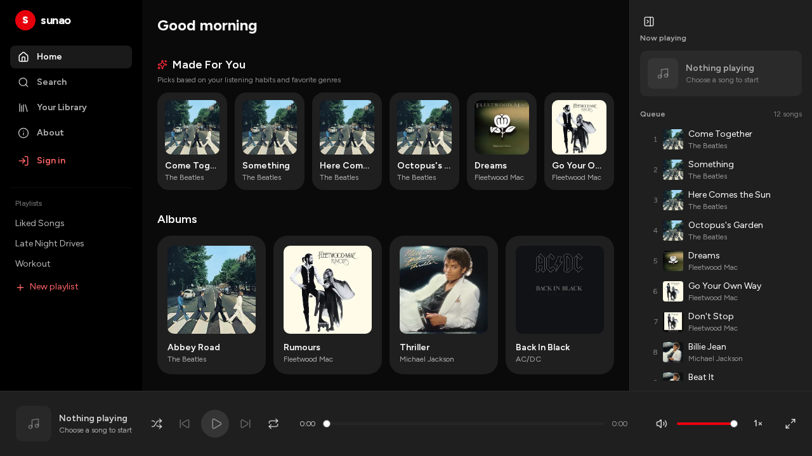
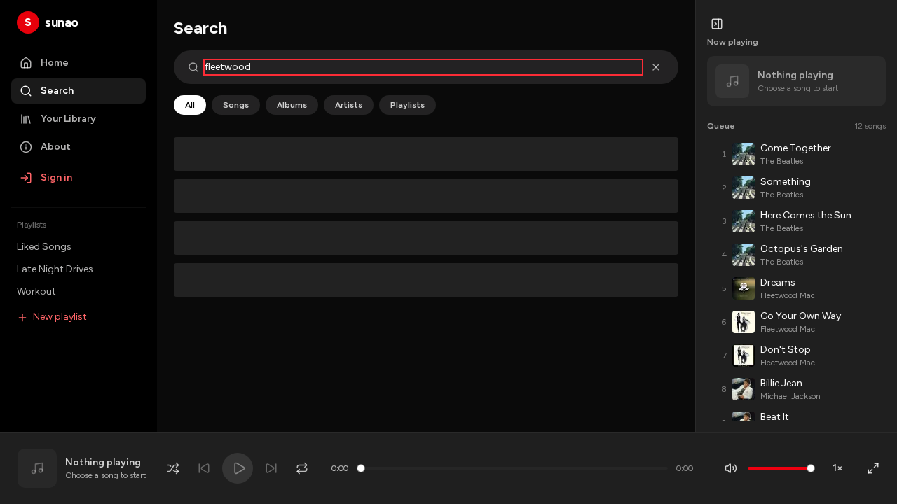
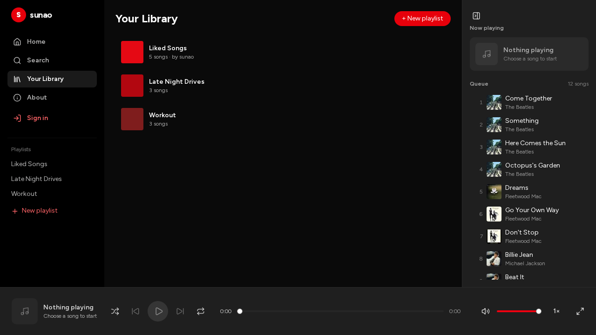
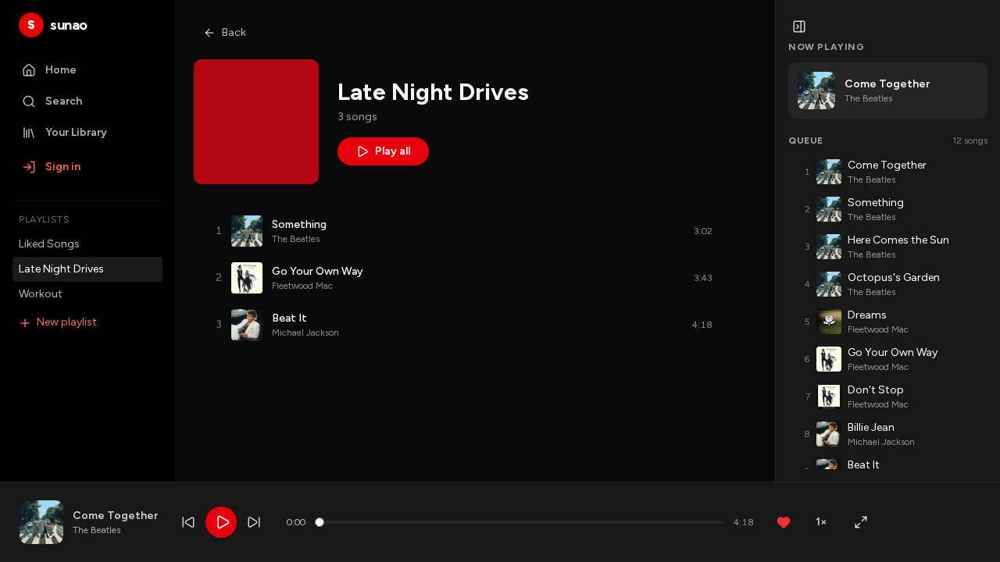
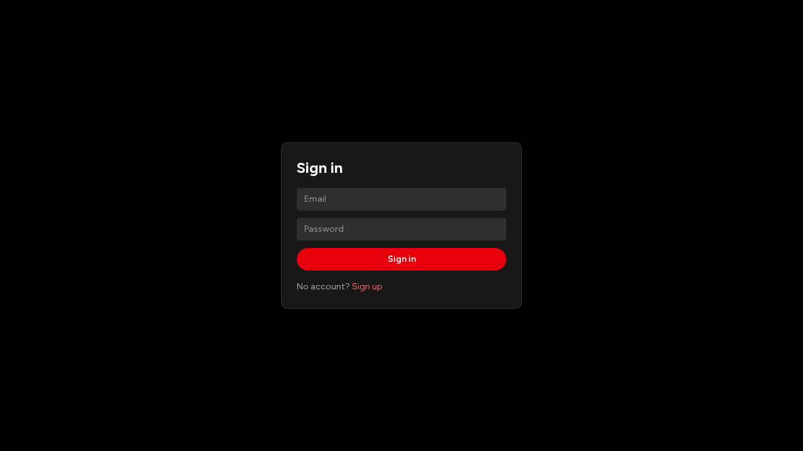
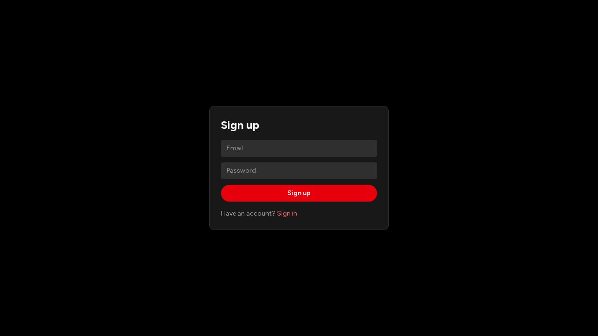
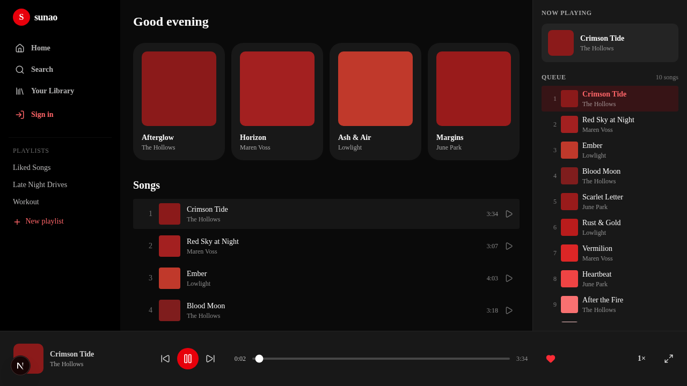

# sunao

A Spotify-like music player. Red theme, dark UI. Built with Next.js 15, Tailwind v4, shadcn/ui, Supabase, Zustand, and TanStack Query.

**Live demo:** https://sunao-omega.vercel.app

<video autoplay loop muted playsinline width="960">
  <source src="https://raw.githubusercontent.com/paramcodes/sunao/main/artifacts/readme/demo.webm" type="video/webm" />
  <source src="https://raw.githubusercontent.com/paramcodes/sunao/main/artifacts/readme/demo.mp4" type="video/mp4" />
</video>

Fallback (GIF): 

## Screenshots

| Home | Search |
|---|---|
|  |  |

| Library | Playlist detail |
|---|---|
|  |  |

| Login | Sign up | Now playing |
|---|---|---|
|  |  |  |

## Features

Playback
- Play / pause, previous / next track
- Seek scrubber with position + duration
- Playback speed (0.5×, 1×, 1.25×, 1.5×, 2×)
- Like / unlike the current track
- Now-playing card and queue panel; click any queue item to play
- Auto-advance to the next track when a song ends
- Audio: 30-second previews + album artwork fetched from the iTunes Search API (no API key); cached per title+artist, falls back to a bundled sample tone on failure

Browse
- Home: album grid + song list (click a song to play)
- Search: filter songs by title or artist; empty state when nothing matches
- Library: list playlists, create a playlist (writes to Supabase, or a local store without a backend)
- Playlist detail: cover, song count, "Play all", remove a song, empty state

Auth (Supabase)
- Email + password sign in / sign up
- Proxy (`src/proxy.ts`) refreshes the session and protects `/library` and `/playlist/*`
- Graceful no-op when Supabase env vars are missing, so the app runs without a backend

Mobile
- Bottom nav (Home / Search / Library / Queue) below `lg`, replacing the hidden sidebar
- Queue opens in a bottom sheet
- Responsive player bar: compact player with a progress line on phones, full controls from `md` up

Polish
- Loading skeletons for the home route (reduces layout shift)
- Empty states for search and playlists
- Accessibility: ARIA labels on player controls, tooltips with keyboard hints, Space-bar play/pause, focus-visible styles
- Performance: `optimizePackageImports` for lucide-react and react-query; lazy-loaded queue panel
- Motion: shared easing tokens, pointer-gated hover, press feedback, reduced-motion aware

## Tech stack

See [docs/stack.md](docs/stack.md) for the full list with rationale. Highlights:

- Next.js 15 (App Router, Turbopack) + React 19
- TypeScript (strict)
- Tailwind CSS v4 + shadcn/ui (Radix primitives)
- Zustand (player state) + TanStack Query (server state)
- Supabase (Postgres, Auth, RLS) + Zod (boundary validation)
- Vitest + React Testing Library, Playwright (E2E)
- Biome (lint + format), Husky + lint-staged

## Getting started

Prerequisites: Node 20+, pnpm 12+.

```bash
pnpm install
cp .env.example .env.local   # optional; app runs without Supabase
pnpm dev
```

Open http://localhost:3000.

Environment variables (optional, for Supabase data + auth):

```
NEXT_PUBLIC_SUPABASE_URL=
NEXT_PUBLIC_SUPABASE_ANON_KEY=
```

Without them the app falls back to static seed data and skips auth.

## Scripts

| Command | What it does |
|---|---|
| `pnpm dev` | Dev server (Turbopack) |
| `pnpm build` | Production build |
| `pnpm start` | Run production build |
| `pnpm typecheck` | TypeScript strict check |
| `pnpm lint` / `pnpm lint:fix` | Biome check / autofix |
| `pnpm format` | Biome format |
| `pnpm check:comments` | Comment allowlist check |
| `pnpm test` / `pnpm test:watch` | Vitest |
| `pnpm test:e2e` | Playwright |

## Project structure

```
src/
  app/            routes (App Router), layout, globals.css
  components/
    ui/           shadcn primitives (button, slider, skeleton, empty-state, ...)
    layout/       app shell (sidebar, player bar, queue panel)
  hooks/          useAudio (HTMLAudioElement <-> store sync)
  stores/         Zustand (player)
  lib/            utils, query client, Supabase clients, schemas, queries, data
  types/          shared types
docs/             wiki (stack, architecture, design system, workflows, roadmap)
e2e/              Playwright specs
supabase/         migrations + seed
scripts/          check-comments.mjs
```

## Contributing

1. Branch from `main`: `feat/phase-N-...` or `fix/...`.
2. One focused change per commit (conventional commits: `feat:`, `fix:`, `chore:`).
3. Run the full check before pushing: `pnpm typecheck && pnpm lint && pnpm check:comments && pnpm test && pnpm build`.
4. Open a PR. CI must pass (typecheck, lint, comments, test, build). Squash-merge after green; delete the branch.

Notes for contributors
- Comment policy: only allowlisted comments (SPDX/license, eslint-disable, @ts-expect-error, TODO/FIXME with an issue number, public JSDoc). Everything else is rejected by `pnpm check:comments`. Keep code self-documenting; comment only a non-obvious *why*.
- Pre-commit (Husky + lint-staged) runs Biome on staged files.
- Verification skill + feature map live under `.opencode/skills/verify-sunao/` and `README.md` feature map; update them when adding a phase.

## Docs

- [docs/README.md](docs/README.md) — wiki index
- [docs/architecture.md](docs/architecture.md) — app structure and data flow
- [docs/design-system.md](docs/design-system.md) — tokens, components, motion
- [docs/workflows.md](docs/workflows.md) — dev commands and PR flow
- [docs/roadmap.md](docs/roadmap.md) — multi-phase plan

## Status

All phases 0–6 complete. Deployed to https://sunao-omega.vercel.app.
EOF
echo written